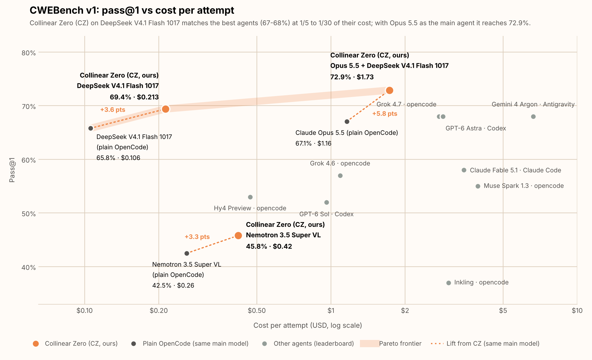
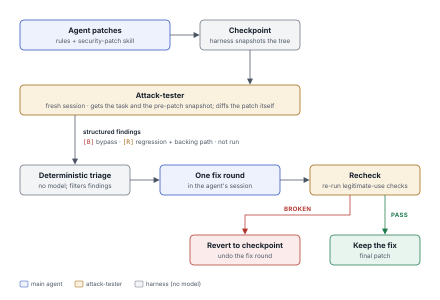

#  Collinear Zero

Turn a security finding (a CVE, advisory, CWE description, audit or scanner result) into a fix with the coding agent
you already use (opencode, Claude Code or Codex), then check that fix with an **independent attack-tester** before
you accept it.

## Results



On CWE-bench v1, Collinear Zero raises pass@1 for every model it wraps, putting DeepSeek V4.1 Flash level with the
best agents at 1/5 to 1/30 of their cost. With Claude Opus 5.5 as the patching agent and DeepSeek V4.1 Flash as the
attack-tester, it reaches 72.9% (+5.8 points over Opus 5.5 in plain opencode) at $1.73 per attempt.

## How it works



- The **attack-tester** runs in its own session. It sees only the finding and the original snapshot, runs attacks
and legitimate inputs against the patch, and cannot edit the code.
- The **triage** uses no model. It forwards every bypass, plus any regression that a file in the repository (a test,
doc or example) backs, plus requirements the tester did not run. It drops everything else.
- The agent gets **one fix round**. If the recheck finds that round broke legitimate behavior, it is reverted.

Why it is built this way is in [docs/how-it-works.md](docs/how-it-works.md).

## Quick start

```bash
# 1. Install cz and the rules for Claude Code, opencode and Codex
git clone <this repository> collinear-zero && cd collinear-zero && ./install.sh

# 2. In the repository to fix, save the finding (CVE text, advisory, scanner output…)
cd /path/to/your/repo && $EDITOR finding.md

# 3. Patch it, review the patch, and give the agent one fix round
cz run --task finding.md --harness claude      # or opencode / codex
```

<details>
<summary>Install options</summary>

```bash
./install.sh claude                   # one harness only
SCOPE=project ./install.sh claude     # into the current repository instead of your user config
pip install . && cz install --harness claude opencode codex   # by hand
cz uninstall --harness claude         # remove everything cz install added
```

Every file `cz install` edits is backed up once as `*.cz-bak`.

</details>

## Ways to run

| Mode | What you do | When the review runs |
|---|---|---|
| **Hands-off**, any harness | `cz run --task finding.md --harness <h>` | automatically, after the agent stops |
| **Claude Code**, interactive | ask Claude to fix the finding | automatically, when Claude stops (Stop hook) |
| **opencode / Codex**, interactive | ask the agent to fix the finding, then `cz review` | when you run it; after the agent acts on it, `cz recheck` |

- Pick models with `--model` and `--tester-model`, e.g. `cz run … --model sonnet --tester-model opus`.
- `cz review --session <id>` hands the findings to the agent's session for you.

## Commands

| Stage | Command | What it does |
|---|---|---|
| **Set up** | `cz install` / `cz uninstall --harness <h>…` | add or remove the rules, skill and agents |
| **Fix** | `cz run --task <file> --harness <h>` | the whole loop, end to end |
| | `cz init --task <file>` | record the finding and snapshot the repo (interactive agents run this themselves) |
| **Review** | `cz review` | run the attack-tester and triage on the current tree |
| | `cz recheck` | after a fix round: recheck, and revert it if it broke something |
| **Check and undo** | `cz diff` | the patch against the original |
| | `cz regress -- <test command>` | which tests newly fail on the patch |
| | `cz revert [--to orig]` | restore the review checkpoint (or the original) |
| **Workspace** | `cz status` / `cz reset` | show the active task / delete the workspace |

`cz install --with-blind-tests` adds an opt-in test-writer. It is off by default: in our runs, its tests rarely caught a
failing patch. `cz --help` lists the rest.

## Safety

1. The agent and the tester **run code from your repository on your machine.** Use a container or VM for code you do not trust.
2. `cz run --harness claude` **accepts edits and allows Bash without asking** (headless mode cannot prompt).
3. The tester has no edit tools where the harness allows that, and any change it makes to the tree is undone.
4. Each workspace handles **one task at a time.** Set `CZ_WS` to run several.

## Harness support

| | Rules + skill | Review loop in `cz run` | Interactive review | Benchmarked |
|---|---|---|---|---|
| opencode | `AGENTS.md`, `skills/` | yes | `cz review` / `cz recheck` | yes |
| Claude Code | `CLAUDE.md`, `skills/` | yes | automatic (Stop-hook gate) | no |
| Codex | `AGENTS.md`, `skills/` | yes (experimental) | `cz review` / `cz recheck` | no |

Details per harness are in [docs/harnesses.md](docs/harnesses.md).

## Cite

```bibtex
@software{collinear_zero_2026,
  title  = {Collinear Zero: a Pareto-optimal defensive cyber harness for LLM agents},
  author = {{Collinear AI}},
  year   = {2026},
  url    = {TODO},
}
```

## License

Apache-2.0. The skill adapts material from codex-security (OpenAI) and deepsec (Vercel); see [NOTICE](NOTICE).
